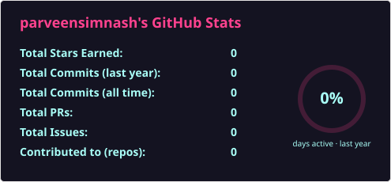
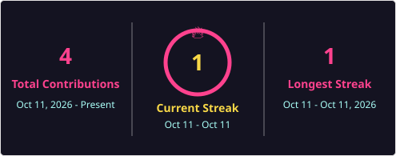
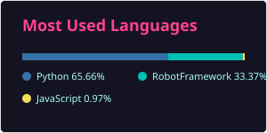

# 💫 About Me:

👋 Hi, I'm **Parveen Simnash**

🧪 QA Engineer | Manual & Automation Testing | Robot Framework | Jira
📍 Ranipet, Tamil Nadu, India
📧 simnashsyed@gmail.com | 📞 +91 73958 97864
🔗 LinkedIn: https://www.linkedin.com/in/simnash-s-5a6514337

---

### 👩‍💻 About Me

I'm a QA Engineer with 1+ year of experience in manual and automation testing of web applications at Opti Supply AI (CSCS), working on an AI-driven supply chain and procurement platform.

I turn requirements and acceptance criteria into effective test scenarios, catch defects early, and improve release quality using **Robot Framework, Python, JavaScript, Jira and Agile** delivery, achieving:
- 🤖 60+ regression test cases automated with Robot Framework, cutting manual regression effort by 30%
- 🐞 70+ defects logged and tracked in Jira across 8+ end-to-end business workflows
- 🧪 100+ test cases designed and executed, with a 25% gain in automation suite stability

🎓 MCA graduate (GPA 9.0), Anna University.

I enjoy owning quality end-to-end — from acceptance criteria to release sign-off.

## 🌐 Socials:
 

# 💻 Tech Stack:
          

### 🔍 Testing Focus
`Manual Testing` · `Functional` · `Regression` · `UI` · `End-to-End` · `Smoke & Sanity` · `Keyword-Driven Automation` · `Defect Life Cycle` · `Agile / Scrum` · `SDLC / STLC`

# 📊 GitHub Stats:
 
 

### ✍️ Random Dev Quote

---

